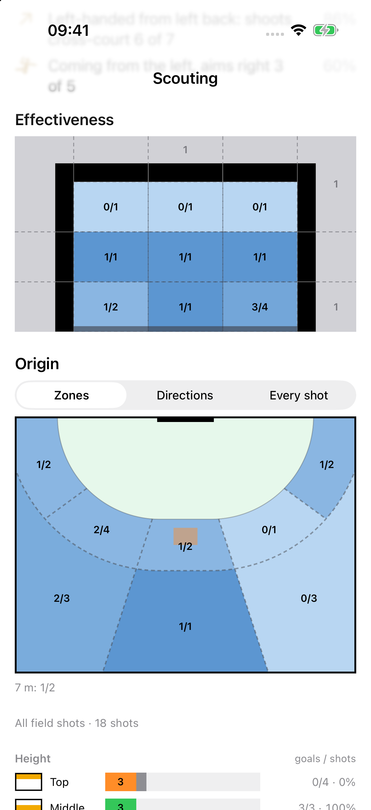
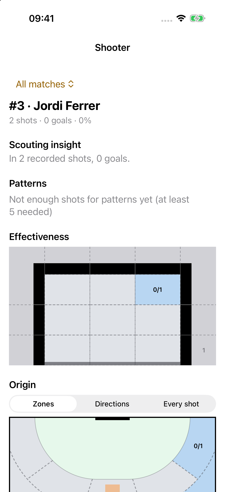
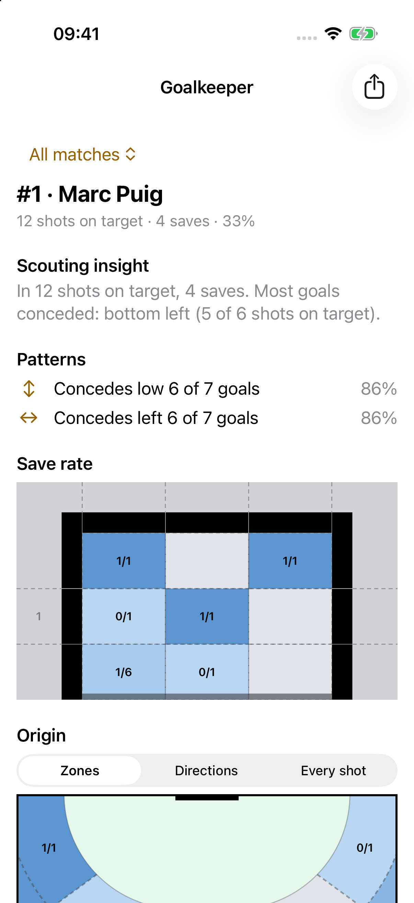
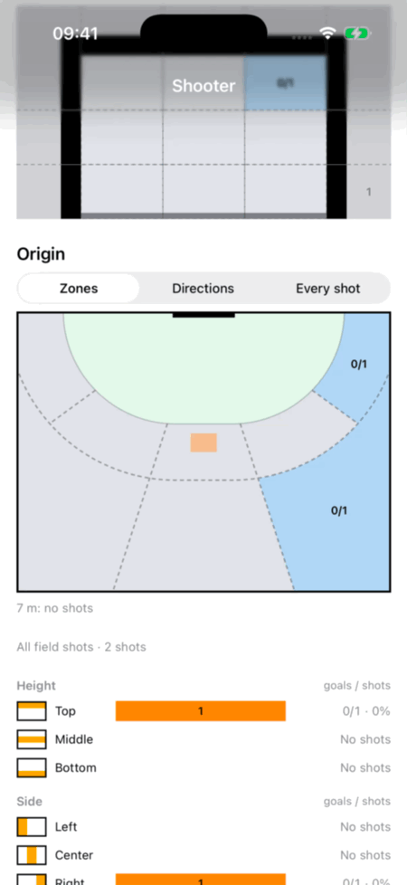

# Keepercent

> *keeper + percent* — a handball goalkeeper's scouting tool: rival shots turned into percentages.

An offline iPhone/iPad app for handball goalkeepers scouting rival shooters and goalkeepers, with optional tracking of their own club's goalkeepers. Built from scratch for the **ACoding Hackathon 2026** (Apple Coding Academy), delivered when the event ended on September 27, and now continued as a personal project without deadlines.

## The problem

Before a match, a goalkeeper wants to know who shoots from where, towards which part of the goal, and how it ends. Keepercent focuses on those recorded shots rather than full match statistics.

That includes *which* post or part of the crossbar was hit, and where a goalkeeper has conceded goals or made saves. Counts and sample sizes keep a recorded result distinct from a prediction.

## Current features

- **Rival teams and manual rosters**, with a seeded demo rival team to explore. An optional **My Club** roster lets matches also track shots faced by your own goalkeepers; rival-only scouting still works without it.
- **Manual shot entry** in live or video sessions: shooter or rival goalkeeper, court origin, goal target, outcome, and optional delivery/approach context. “Video” is session metadata: watch footage externally and use the same entry flow; there is no in-app player or video-timestamp tagging.
- **Match history and scope**: inspect one match or **All matches** in scouting and player cards. Stable player UUIDs link recorded shots to people, while match roster snapshots preserve the number, name and other roster facts used at the time. A match-scoped card uses that snapshot; All matches prefers today's roster header, retaining historical people no longer on the roster.
- **Detailed targets**: left/right post thirds, crossbar thirds, and directional miss sub-zones. A shot log supports deletion and the last recorded shot has one-level Undo; earlier shots are corrected by deleting and re-recording, not in-place editing.
- **Linked scouting cards** for shooters, rival goalkeepers and own goalkeepers. Select a court zone to filter the goal view, then select it again to clear. Heatmaps, direction arrows, individual-shot arrows, and height/side outcome bars use the same recorded data; 7 m throws are shown separately from field play. Own-goalkeeper history uses recorded attribution, not membership of today's roster.
- **Sample-aware statistics and plain-language insights**, including deterministic scouting patterns. Shooter effectiveness and goalkeeper save rate use different denominators; missing data is not a measured 0%.
- **Scoped goalkeeper image reports**, for rival or own goalkeepers, prepared from the selected match or All matches and shared explicitly through the system share interface.

## Screenshots

Synthetic demo data, showing selected portions of the screens rather than complete cards or reports. Select an image to open it at full size.

| Scouting | Shooter | Goalkeeper |
| --- | --- | --- |
| [](docs/assets/readme/scouting.png) | [](docs/assets/readme/shooter-card.png) | [](docs/assets/readme/goalkeeper-card.png) |
| Goal effectiveness and court origins. | Jordi Ferrer: 2 shots, 0 goals. | Marc Puig: 4 saves from 12 shots on target. |

[](docs/assets/readme/shooter-interaction.gif)

**Linked-card interaction:** select a court-origin filter, then tap the same zone again to clear it.

Captured from `e377111e6b533f89812abb84faac346c84037ba3` on iPhone 17 / iOS 26.1, portrait, light appearance, English (`en_US`). [Capture details and verification limits](odd/tasks/archive/readme-foundations.md#rf-3-asset-provenance-and-verification).

## Quick start

Requirements: **Xcode 27**, with **iOS/iPadOS 26** as the minimum deployment target. No backend account or third-party runtime dependency setup is needed.

1. Open `Keepercent.xcodeproj` in Xcode 27.
2. Select the shared `Keepercent` scheme and an iPhone or iPad simulator running iOS/iPadOS 26 or newer, then Run. For a physical device, configure signing with your own development team.
3. Explore the seeded demo rival team's roster and scouting cards, or create a rival team, add players manually, and start a session. To record your own goalkeeper's history, configure **Own Team Roster** from the Rival Teams toolbar and include its match roster when starting a new session. **My club** shows the resulting history; an own roster alone does not attribute past shots.

Run the domain tests independently of the app or simulator:

```sh
swift test --package-path Domain
```

## Architecture

Dependencies point **from the app into the domain**, not the other way around:

```text
App: feature containers, SwiftData adapters, SwiftUI presentation
    -> KeepercentDomain: values, validation, geometry, statistics
```

Containers convert stored records to domain values and pass results to presentation. The domain itself does not depend on SwiftUI, SwiftData, or app views.

| Layer | Responsibility |
| --- | --- |
| [Domain](Domain/) | Pure Swift package: shot/roster/session values, validation, court/goal geometry, `StatsEngine`, patterns and template insight text. Swift Testing suites cover deterministic logic without a simulator; no third-party dependencies. |
| [Persistence](Keepercent/Persistence/) | SwiftData adapters store primitive codes and coordinates, stable identities and match participant snapshots, then expose rich domain values. The app creates the model container; statistics never receive a `ModelContext`. |
| [Features](Keepercent/Features/) | Feature-first organization for teams, My Club, sessions, scouting, cards and reports. Containers own queries, stored-model access and writes, then pass domain values to presentational views. |
| [Design system](Keepercent/DesignSystem/) | Shared goal/court drawing, palette and outcome bars. `LinkedZonesView` is reused by scouting and shooter/goalkeeper cards, with shooter effectiveness or goalkeeper save rate supplied as the reading. |

For a concrete read path, [ScopedMatchData](Keepercent/Persistence/ScopedMatchData.swift) selects match shots and player headers before building a domain engine. [OwnGoalkeeperCardView](Keepercent/Features/MyClub/OwnGoalkeeperCardView.swift) filters that engine by stable goalkeeper identity and passes values to the shared goalkeeper content view. Shot-entry containers validate domain values before persisting them.

## Native stack and offline boundaries

- **Swift and Foundation** for domain values, calculations and localized text; **Swift Testing** for domain tests.
- **SwiftUI** for navigation and presentation, `Canvas` for court/goal drawing, and ordinary SwiftUI views for outcome bars.
- **SwiftData** for the local team, roster, match/session and shot store.
- **SwiftUI `ImageRenderer` and `ShareLink`** for explicit report-image export.

The app ships Apple SDK code and its own local domain package, with **no third-party code in the app binary**. Development tooling is a separate concern, not a runtime dependency.

Scouting and insights work offline with local storage; the app does not require a backend, sign-in or an app-managed cloud-sync service. Sharing is a deliberate boundary: a report image can leave the app when you choose a destination in the system share interface. This is not a guarantee about device backups or how a chosen recipient handles that image.

## AI usage

Generative AI was used as a coding assistant during development. The project requires the author to understand and be able to explain the resulting code.

**The current app does not use a generative model for runtime insights.** `StatsEngine` computes statistics and scouting patterns deterministically; `TemplateInsightWriter` and `PatternPhraser` turn those facts into localized text. The insight view calls the template writer directly, rather than selecting a model when available. Development AI assistance is not a shipped Foundation Models feature.

## Status and remaining work

This README describes the integrated match/club app, not just the original hackathon MVP. Roster OCR/PDF import remains deferred and unmerged; manual roster entry is the current path.

The polish/accessibility task is closed with limited verification and recorded debt, not a full accessibility pass. Broader visual coverage and manual VoiceOver acceptance remain incomplete. No complete UI acceptance or App Store readiness is claimed. Public screenshots and a short interaction GIF are available above.

See the [original product plan](docs/mvp.md) for historical intent and the [task ledger](odd/tasks/keepercent.md) for current progress. The [README foundations task](odd/tasks/archive/readme-foundations.md) records this bounded documentation update and its verification.
